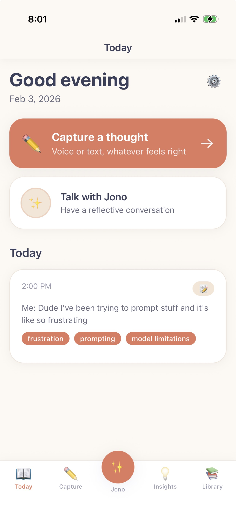
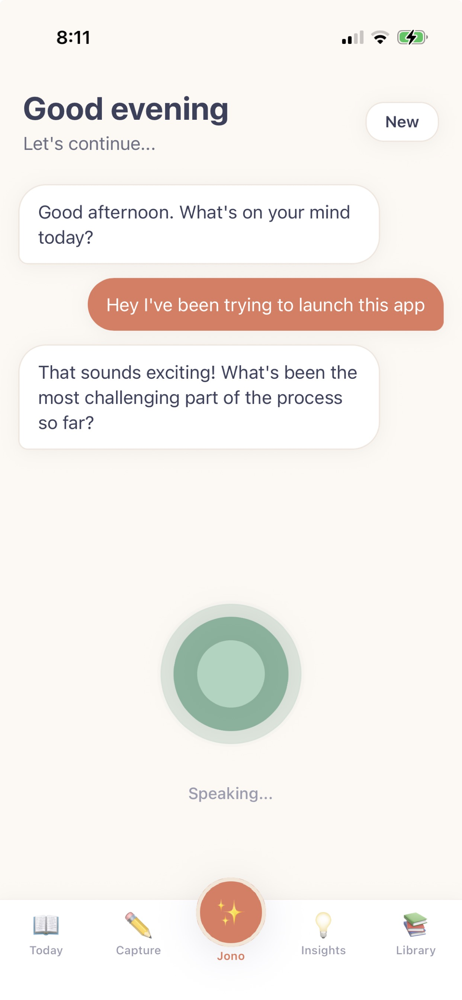
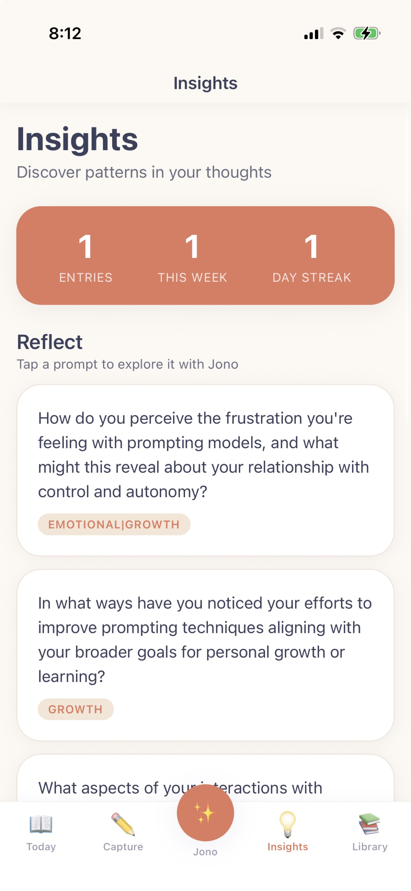

<p align="center">
  
</p>

<h1 align="center">Jono</h1>

<p align="center">
  <strong>Speak your thoughts, discover yourself.</strong>
</p>

<p align="center">
  A voice-first, privacy-focused journaling app powered by Apple Intelligence.
</p>

<p align="center">
  <a href="https://myjono.app">Website</a> &bull;
  <a href="#features">Features</a> &bull;
  <a href="#getting-started">Getting Started</a> &bull;
  <a href="#contributing">Contributing</a> &bull;
  <a href="#license">License</a>
</p>

---

## What is Jono?

Jono is an AI journaling companion that turns scattered thoughts into deep personal insights. Record voice notes, have reflective AI conversations, and transform your thoughts into poems, letters, essays, and more — all processed locally on your device.

**Your data stays on your device. Always.**

<p align="center">
  
  
  
</p>

## Features

- **Voice Recording** — Capture thoughts instantly with Apple Intelligence-powered transcription
- **AI Conversations** — Reflective dialogue with Jono that asks follow-up questions to help you think deeper
- **Searchable Thoughts** — Every voice note is transcribed and indexed for easy search
- **Content Transformation** — Turn entries into poems, letters, essays, gratitude pieces, lessons, and mantras
- **Personal Insights** — Pattern recognition that identifies themes and trends over time
- **Trend Analysis** — Visualize how your thoughts and themes evolve
- **Privacy by Design** — No cloud, no tracking, no account required. Everything stays on-device

## Tech Stack

- [React Native](https://reactnative.dev/) + [Expo](https://expo.dev/) (SDK 54)
- [Apple Intelligence](https://developer.apple.com/apple-intelligence/) via [`@react-native-ai/apple`](https://www.npmjs.com/package/@react-native-ai/apple)
- [expo-speech-recognition](https://github.com/nickmccurdy/expo-speech-recognition) for on-device transcription
- [expo-av](https://docs.expo.dev/versions/latest/sdk/audio-video/) for audio recording
- [Zustand](https://github.com/pmndrs/zustand) for state management
- [AsyncStorage](https://react-native-async-storage.github.io/async-storage/) for local persistence
- [Expo Router](https://docs.expo.dev/router/introduction/) for file-based routing

## Getting Started

### Prerequisites

- **Node.js** 18+
- **iOS device** with iOS 18.1+ (Apple Intelligence features require iPhone 15 Pro or later, or iPad with M1+)
- **Xcode** 16+ (for iOS builds)
- An [Expo](https://expo.dev/) account (free)

### Installation

```bash
# Clone the repository
git clone https://github.com/priyankark/jono-voice-journal.git
cd jono-voice-journal

# Install dependencies
npm install

# Start the development server
npx expo start

# Run on iOS simulator
npx expo run:ios

# Or run on a physical device
npx expo run:ios --device
```

### Development Build

For full native functionality (microphone, speech recognition), you need a development build:

```bash
# Install EAS CLI
npm install -g eas-cli

# Create a development build
eas build --profile development --platform ios
```

## Project Structure

```
jono/
├── app/                    # Expo Router screens
│   ├── (tabs)/             # Tab-based navigation
│   │   ├── index.tsx       # Home / Today view
│   │   ├── assistant.tsx   # AI conversation (the Orb)
│   │   ├── record.tsx      # Voice recording
│   │   ├── search.tsx      # Search entries
│   │   ├── articles.tsx    # Content library
│   │   ├── insights.tsx    # Personal insights
│   │   ├── trends.tsx      # Trend visualization
│   │   └── settings.tsx    # Settings
│   ├── entry/[id].tsx      # Entry detail view
│   ├── onboarding/         # Onboarding flow
│   └── legal/              # Privacy policy & terms
├── components/             # Reusable UI components
│   ├── AnimatedOrb.tsx     # The Jono orb
│   ├── VoiceRecorder.tsx   # Voice recording UI
│   ├── EntryCard.tsx       # Journal entry card
│   ├── onboarding/         # Onboarding screens
│   └── teaching/           # In-app teaching tips
├── services/               # Business logic
│   ├── assistantService.ts # AI conversation engine
│   ├── articleGenerator.ts # Content transformation
│   ├── insightsService.ts  # Insight generation
│   ├── transcription.ts    # Speech-to-text
│   └── trendAnalyzer.ts    # Trend analysis
├── stores/                 # Zustand state stores
│   ├── journalStore.ts     # Journal entries
│   ├── onboardingStore.ts  # Onboarding state
│   └── teachingStore.ts    # Teaching tips state
├── hooks/                  # Custom React hooks
├── constants/              # Theme & styles
├── types/                  # TypeScript types
└── utils/                  # Utility functions
```

## How It Works

Jono has two primary modes:

1. **Record Mode** — Tap to record a voice note. Your speech is transcribed on-device using Apple's speech recognition. Entries are automatically tagged and searchable.

2. **Assistant Mode** — Tap the glowing orb to start a conversation with Jono. It asks thoughtful follow-up questions to help you reflect deeper. The conversation is saved as a journal entry.

All AI processing happens on-device via Apple Intelligence. On devices without Apple Intelligence, Jono gracefully falls back to simpler prompts and local processing.

## Contributing

We welcome contributions! Please see [CONTRIBUTING.md](CONTRIBUTING.md) for guidelines.

### Quick Start for Contributors

1. Fork the repo
2. Create a feature branch (`git checkout -b feature/my-feature`)
3. Make your changes
4. Run the app to verify (`npx expo start`)
5. Commit and push
6. Open a Pull Request

## Privacy

Jono is built with privacy as a core principle:

- **No cloud storage** — All data stays on your device
- **No accounts** — No sign-up or registration required
- **No tracking** — Zero analytics, telemetry, or usage tracking
- **No network calls** — Core features work entirely offline
- **On-device AI** — Speech recognition and AI use Apple's on-device processing

See our full [Privacy Policy](app-store/PRIVACY_POLICY.md).

## License

This project is licensed under the [MIT License](LICENSE).

## Acknowledgments

Built with love for journaling.

---

<p align="center">
  <a href="https://myjono.app">myjono.app</a>
</p>
